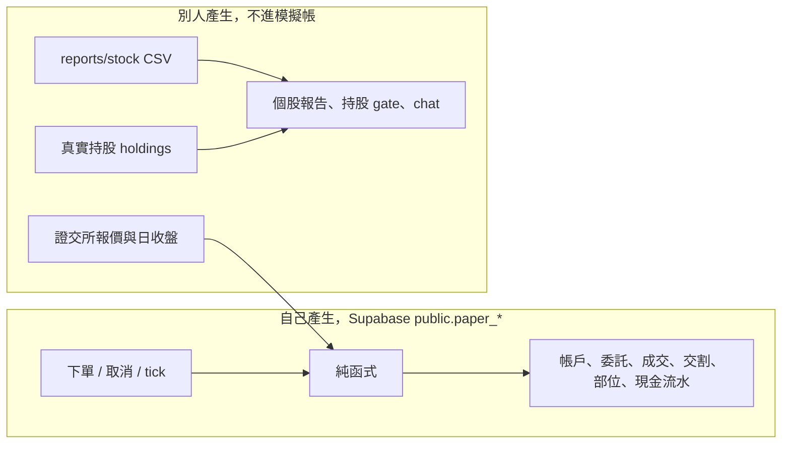
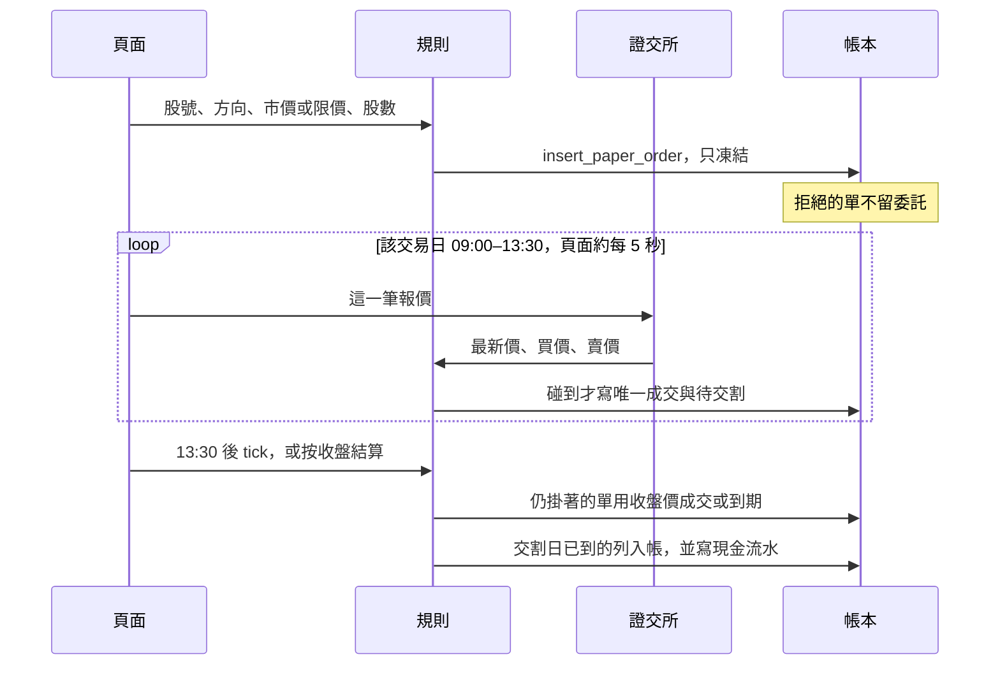

# 模擬帳與資料邊界

個人模擬帳放在 Supabase。籌碼、報告、真實持股不進這本帳。問句只對這本帳裡已登記的指標，套目錄中的 SELECT。

盤中撮合、手續費、漲跌停和交割的細節見 [模擬即時交易](./paper-live-trading.md)。這份只定資料放哪裡、誰可以寫、問句怎麼碰到數字。

## 三個詞落在哪裡

這三個詞不再做成一層「自然語言查任意表」的查詢口。

| 詞 | 在這套系統裡的意思 | 不採用的做法 |
| --- | --- | --- |
| ERP | 你自己產生的帳：帳戶、委託、凍結、成交、交割、現金。登入使用者是唯一寫入者，規則先算完，資料庫只寫一次。 | 把籌碼、持股、盤前收成一套進銷存，或一個共用查詢層。 |
| Schema linking | 問句先對上股票、交易日、方向和指標，得到一組連結。名稱用上市上櫃名冊，不在帳本裡找「台積電」這一欄。 | 問句對 FinMind 原始欄，再挑「名稱最接近的欄位」。 |
| Text-to-SQL | 連結成功後，套該指標在目錄裡的那條 SELECT，參數是使用者、股票、交易日和方向。寫入仍是 `insert_paper_order` 這幾個函式。 | 讓模型看完整 schema 自己寫 JOIN。對不上目錄的語句不執行。 |

籌碼問句仍走 `stock-winning-rate` 的報告。事實是 `reports/stock/{日期}/{代碼}/` 的 CSV，由 `fetch_chips` 寫入，報告與 chat 讀這份檔。那條路不經過模擬帳，也不再複製進 SQLite 或 `analytics` schema。

## 兩種資料

報價是撮合的輸入，不是帳本的一列。抓不到就讓單子繼續掛著，不把猜的價格寫進資料庫。

真實持股 `holdings` 和模擬部位 `paper_positions` 是兩本帳。模擬成交不改真實持股。Agent 沒有下單工具。

## 模擬帳有哪些表

都在 `public`，列上的 `user_id` 對到登入使用者。列級安全開啟。網站經 `lib/paper-db.ts` 呼叫函式寫入，不在瀏覽器組 SQL。

| 表 | 一列是什麼 | 誰寫 |
| --- | --- | --- |
| `paper_accounts` | 這個使用者的現金餘額，單位是分。不能為負。 | `open_paper_account` 開戶；交割函式改餘額。 |
| `paper_orders` | 一張委託。狀態是掛著、已成交、已到期、已取消、已拒絕。沒有成交、而且交易日早於今天的到期、取消、拒絕列，會在下一次讀帳或結算時刪掉。已成交的留下。 | `insert_paper_order`、`cancel_paper_order`、收盤函式、`purge_stale_paper_orders`。 |
| `paper_fills` | 一張委託的唯一成交。價格、股數、手續費、稅、交易日。 | 收盤與盤中撮合寫入，每張委託最多一列。 |
| `paper_settlements` | 這筆成交的交割。`settle_on` 是成交交易日之後的第二個交易日。狀態是待交割或已交割。 | 成交時插入；交割日到了才改成已交割。 |
| `paper_positions` | 已交割股數與均價。每個使用者每檔一列。 | 只有交割買進或賣出時更新。待交割的股票不在這裡。 |
| `paper_cash_entries` | 現金流水。只有開戶，或某一張委託的交割。 | 開戶一筆 1,000,000 元。之後每一張委託最多一筆交割流水。 |

金額一律是分。`100000000` 是開戶的 1,000,000 元。股數可以不滿 1000，至少 1 股。

現金餘額只在插入 `paper_cash_entries` 時變動。同一張委託的交割流水有唯一索引，函式跑兩次不會扣兩次錢。成交當下現金還不動：買單先凍結，交割日才從餘額扣掉成交金額加手續費；賣單交割日才把淨收入加回餘額。

可用現金不是另一欄。它是餘額減掉還掛著的買單凍結，再減掉待交割買單。凍結差額回到可用金額，不另寫一筆流水。

## 一筆資料怎麼走

時鐘用台北時間，交易日用證交所開休市表。13:30 前送出算當日，之後算下一個交易日。週六、週日和休市送出的單，交易日也是下一個交易日。

寫入只有這四個函式：

| 函式 | 寫進帳的內容 |
| --- | --- |
| `open_paper_account` | 帳戶，以及一筆開戶流水。 |
| `insert_paper_order` | 掛著的委託和凍結。不成交。 |
| `cancel_paper_order` | 只有掛著的單可以取消，凍結釋放。 |
| `apply_paper_close` | 純函式已經算出的成交、到期、交割。帶著讀到的現金餘額；餘額已被另一次改過就重讀再算。 |

盤中報價只在該張單的交易日 09:00–13:30 使用。報價時間早於下單的不用。人離開頁面時閃過的價格不補。13:30 之後仍掛著的單改看日收盤：市價成交，限價碰到才成交，沒碰到就到期並釋放凍結。還沒有收盤價就繼續掛著。

交割日到了，買單把股數加進 `paper_positions` 並重算含手續費的均價；賣單把淨收入寫入現金流水，並從部位移出成本。

## 問句怎麼碰到數字

問的是模擬帳裡的成交價、限價或均價，走 `POST /api/paper/ask`。連結在 `lib/paper-link.ts`，執行在 `lib/paper-link-query.ts`。問句文字不拼進 SQL。現金和凍結仍讀 `GET /api/paper`。

| 問句 | 讀哪裡 |
| --- | --- |
| 現金、可用、凍結 | `GET /api/paper`。可用由餘額和凍結算出。 |
| 掛著的單、成交、到期原因 | `paper_orders`、`paper_fills`。成交價是碰到的報價或收盤價。 |
| 已交割部位、均價 | `paper_positions`。待交割股數不在這張表。 |
| 為什麼現金變了 | `paper_cash_entries`。只有開戶和交割。 |

問的是外資、融資、主力、收盤、真實持股損益，就讀報告 CSV 和 `holdings`。模擬部位不能拿來回答「我實際有幾張」。報告上的試算也不能寫回 `paper_accounts`。

成交價、限價要有股票、買進或賣出，以及交易日。問「最新」或「最近」時，交易日改成該方向最近一個有紀錄的交易日，同一天多筆成交都列出、不平均。「價錢」和「多少股」都算成交價。均價是目前已交割部位，不帶交易日。外資、融資、主力對不上這本帳，就拒答。另一條 SQL 若和目錄語句不一致，改執行目錄裡的那條。

## 非交易時段

現在沒有盤，帳仍用真實的台北時間。

可以做的是下一個交易日的預掛：送出後凍結，可以取消，頁面顯示休市。這段不成交。證交所介面在休市時常還回得到上一個交易日的最後一筆；成交時間早於這張單，這筆報價整段不用。

撮合規則用測試裡傳進去的時鐘和報價驗證，帳在記憶體，不寫 Supabase。不把回放的成交寫進登入使用者的 `paper_fills`。真實帳戶的交易日和交割日若被改成一段沒有發生的行情，下一個交易日的報價會對著錯誤的成交，冪等和 T+2 會一起錯。

星期一 09:00–13:30，人開著模擬交易頁，真實帳戶才接證交所當下報價。人不在，盤中沒看到的價格不補；晚上按收盤結算，用收盤價決定仍掛著的單。

## 不放進這本帳的東西

- 三大法人、融資、借券、當沖、主力。它們留在報告 CSV。
- 欄位考題、`chip_analytics.sqlite`、Supabase `analytics` 裡的考題表。分支上的這層讀表已經退回，不再作為查詢口。
- 真實持股的均價和張數。
- 盤中每一筆報價的歷史。帳上只留成交那一次的價格。
- 問句文字接進查詢字串。模型寫出的 SQL 必須和該指標的目錄語句相同，否則不採用。
