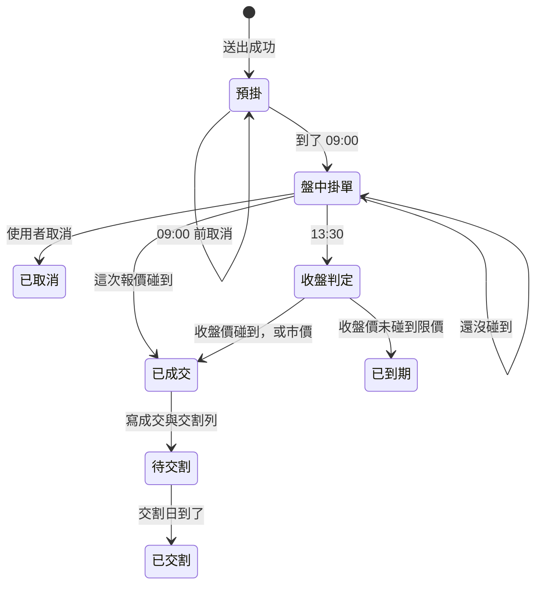
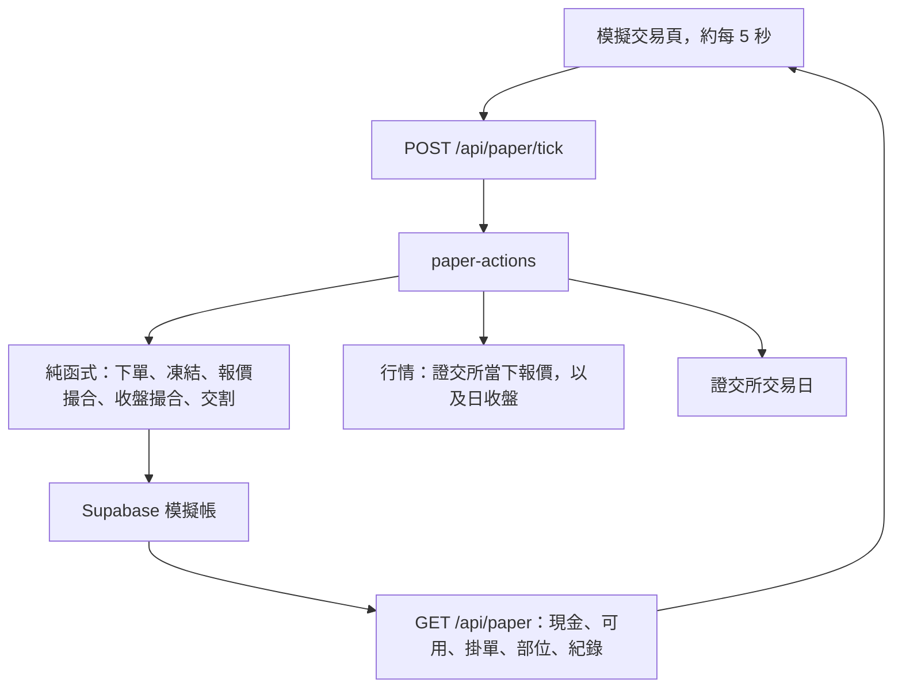
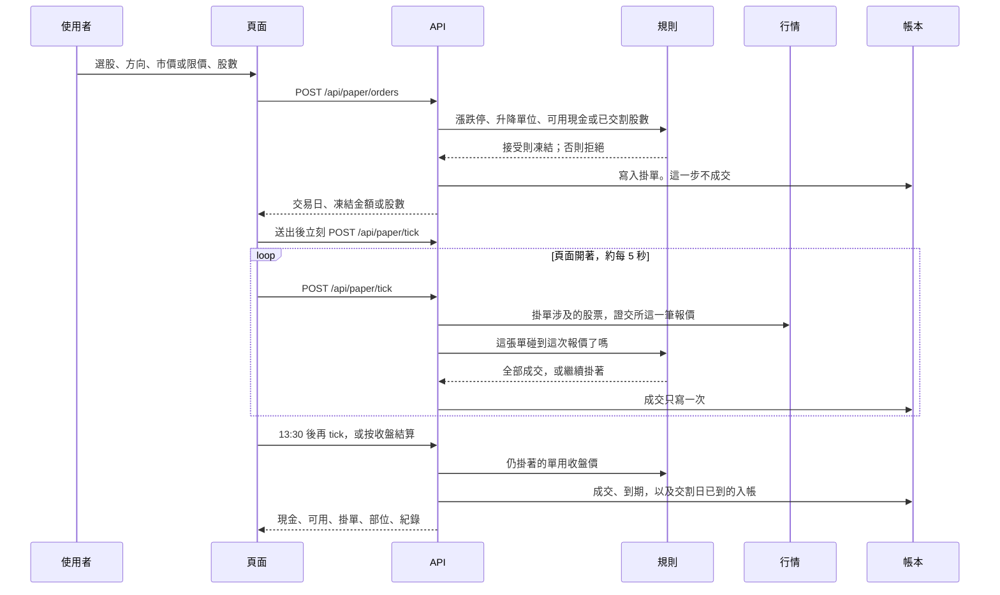

# 模擬即時交易流程架構

個人模擬帳。不寫真實持股 `holdings`，Agent 也不接下單工具。

帳戶、委託、凍結、成交、T+2 交割和現金流水沿用同一套帳。盤中多一層「證交所當下報價 → 撮合」，成交之後仍走原來的交割與流水。13:30 之後沒碰到的單，仍用收盤價收尾。

即時的意思是：交易時段內，用剛剛抓到的一筆證交所報價決定要不要全部成交。不模擬交易所委託簿，不模擬排隊，也不做部分成交。一張單只會全部成交，或繼續掛著，收盤再決定。人離開的那一段沒有報價可回放。

## 仍守住的邊界

- 股數至少 1 股，可以不滿 1000 股。只接受名冊裡的上市、上櫃普通股。
- 現股。不做融資、融券、當沖。
- 成交後、交割前的股票不能賣。賣單只能凍結已經交割的股數。
- 手續費是成交金額的 0.1425% 再打六折，最低 20 元。賣出另加證交稅 0.3%。
- 現金只在交割日經 `paper_cash_entries` 變動。同一張單跑兩次，不能扣兩次錢。
- 漲跌停仍用前一日收盤約 10%，並對齊升降單位。限價超出漲跌停，下單時就拒絕。

## 一整天怎麼走

台北時間。交易日沿用證交所開休市表。

| 時段 | 委託 | 撮合 | 現金與部位 |
| --- | --- | --- | --- |
| 非該張單的交易日，或當日 09:00 前 | 可以送出、可以取消。13:30 後送出的單屬於下一個交易日 | 不成交 | 只凍結 |
| 09:00–13:30 | 可以送出、可以取消還掛著的單 | 用這次證交所報價。碰到就全部成交 | 成交只把凍結改成待交割。現金餘額還不動。買進立刻出現在部位，狀態是待交割 |
| 13:30 起 | 新單改算下一個交易日 | 不再用盤中報價。仍掛著的單改看收盤價。離開頁面時閃過的價格不補 | 交割日到了的成交才入帳：買單記入已交割部位，賣單現金回到帳戶 |

## 分層

畫面不自己算成交。規則放在純函式。資料庫只負責把純函式算出的結果寫進去一次。

| 層 | 檔案 | 做什麼 |
| --- | --- | --- |
| 規則 | `paper-trade.ts`、`paper-ledger.ts` | 漲跌停、凍結、手續費、收盤撮合、交割金額 |
| 時間 | `intradayQuoteReady` | 只有該張單的交易日 09:00–13:30 用當下報價 |
| 行情 | `paper-market.ts`、`paper-quote.ts` | 證交所報價收成 `{ 時間, 最新價, 買價, 賣價 }`，單位是分。日收盤留給 13:30 |
| 盤中撮合 | `paper-live.ts` 的 `matchQuote` | 一張掛單對一次報價。碰到就全部成交 |
| 寫入 | `paper-session.ts` 的 `runPaperTick` | 先用這次報價撮合，再跑原來的收盤與交割 |
| 畫面 | `PaperTradingDashboard.tsx` | 開頁、送出後，以及約每 5 秒呼叫 tick，再讀快照 |

`matchPrint` 和一分鐘 K 的解析還留在程式裡，盤中路徑不再呼叫，抓不到報價時也不改回一分鐘線。

## 一筆單的流程

下單和取消的檢查不變。

1. 股號必須在上市或上櫃普通股名冊。
2. 股數是正整數，至少 1 股。
3. 限價要在前一日收盤的漲跌停內，而且落在升降單位上。
4. 買單凍結現金。限價用限價算，市價用漲停價算，兩邊都先加上手續費。
5. 賣單凍結已交割股數。可用股數 = 已交割股數 − 其他掛著的賣單 − 已成交但還沒交割的賣單。
6. 13:30 前送出算當日，之後算下一個交易日。
7. 只有狀態是「掛著」的單可以取消。取消立刻釋放凍結。

拒絕的單不寫進部位，也不留下一筆委託。

## 盤中報價

行情來自律交所公開接口 `https://mis.twse.com.tw/stock/api/getStockInfo.jsp`。上市用 `tse_2330.tw`，上櫃用 `otc_6488.tw`，多檔用 `|` 接在同一次請求。友達 2409 的 35.45 就是從這裡的最新成交或最佳買價看到的。

一筆報價收成：

| 欄位 | 意思 |
| --- | --- |
| `at` | 我們抓到這次報價的時間 |
| `quoteAt` | 交易所這次報價的時間，畫面上顯示 |
| `last` / `lastAt` | 最新成交價，以及那筆成交的時間 |
| `bid` | 最佳買價 |
| `ask` | 最佳賣價 |

價格是整數分。`z` 有數字就用 `z`；`z` 是 `-` 時改用 `trade.z`。買價、賣價只取第一檔。當天最高價、最低價含有下單前的成交，不讀。

抓不到、或某個價格不是正數時，那個欄位當沒有。整筆抓不到就讓單子繼續掛著，不猜價格，也不改回 Yahoo 一分鐘線。

tick 會略過幾秒內的快取，重新要一筆，避免剛送出的單用到下單前的報價。接著讀畫面時，沿用這一筆，現價和撮合看的是同一次報價。

## 報價撮合

`matchQuote` 只看一張掛單和一筆報價。不讀資料庫，不抓網路。回傳兩種結果之一。

- **繼續掛著。** 這次沒碰到，或要用的那個價格不存在。不到期。
- **全部成交。** 寫成交價、股數、手續費、稅、交割日。買單的待交割金額是成交價乘股數再加手續費。賣單的待交割金額是成交價乘股數，減手續費和證交稅。

先確認這筆報價算不算這張單的：

- 快照時間必須晚於下單時間。下單前抓到的報價整筆不用。
- 最新價還要成交時間也晚於下單。下單前已經印出來的成交，不用來判斷限價。
- 買價和賣價是當下的委託簿。快照晚於下單就可以用，即使最新一筆成交還停在下單之前。

成交規則：

- 市價買單用賣價。賣價沒有就繼續掛著。
- 市價賣單用買價。買價沒有就繼續掛著。
- 限價買單：最新價小於或等於限價，成交價用最新價。否則賣價小於或等於限價，成交價用賣價。兩個都沒到，繼續掛著。
- 限價賣單：最新價大於或等於限價，成交價用最新價。否則買價大於或等於限價，成交價用買價。兩個都沒到，繼續掛著。

同一張單只會有一筆成交。下次 tick 看到它已經成交，就停。

買單若算出的成交金額加手續費超過凍結現金，這次不成交，繼續掛著。正常時段的賣價不會高過漲停，所以市價買單用漲停預扣通常夠付。成交價低於漲停時，凍結差額回到可用金額。差額不是一筆新的現金流水。可用金額是：現金餘額減掉還掛著的買單凍結，再減掉待交割買單。成交之後，凍結從「漲停預扣」改成「實際成交金額」，差額就出現在可用金額裡。

## 收盤與交割

13:30 之後的同一次 tick，順序固定。盤中不再補播離開頁面時沒看到的價格。

1. **收盤撮合。** 對仍掛著的單，沿用 `matchSession` / `matchAtClose`。市價以收盤價全部成交。限價買單要收盤價小於或等於限價，賣單相反。沒碰到的限價到期，原因是「收盤價未碰到限價」，凍結釋放。還沒有收盤價就繼續掛著，不到期。
2. **交割。** 應交割日小於或等於今天的待交割，改成已交割。買單把股數加入部位並重算成本；賣單把淨收入寫入現金，並結算已實現損益。交割日是成交所屬交易日之後的第二個交易日。

成本沿用現在的算法：買進成本含手續費；賣出從部位成本按股數比例移出，剩餘股數的均價再四捨五入到分。

## 誰負責跑

開著模擬交易頁時就呼叫 `POST /api/paper/tick`，大約每 5 秒一次。送出委託後也立刻呼叫一次，市價單不用等到下一輪。分頁切到背景就暫停，回到前景再跑。

「收盤結算」按鈕走同一個 tick。人可以不開著頁面，晚上按一次：盤中沒被看到的價格不會補成交，仍掛著的單用收盤價決定。

兩次 tick 重疊時，帶著讀到的現金餘額去寫；餘額已經被另一次改過，就重新讀帳再算一次。成交與交割的冪等鍵是委託編號。同一筆報價重播，不會產生第二筆成交。

## 畫面

仍是模擬交易這一頁，標題寫明模擬。

- 上方顯示現金、可用、凍結中，以及現在是預掛、盤中、已收盤或休市。
- 下單區送出後先凍結。盤中會立刻用當下報價撮合；還沒到 09:00 的單繼續掛著，等開盤後的報價。
- 掛著的單顯示最新成交價和報價時間，讓人看得出離限價還差多少。取消按鈕留著。
- 部位的未實現損益在盤中用這次最新價，時間顯示在現價下面。收盤後改回日收盤價。沒有價格就留空，不算進合計。
- 成交紀錄的成交價是碰到的那個報價，或收盤價。時間用成交寫入的時間。到期單仍寫原因。

## 失敗時頁面看到什麼

| 情況 | 結果 |
| --- | --- |
| 現金不夠，或賣超過已交割股數 | 拒絕，帳戶不變 |
| 限價超出漲跌停或不合升降單位 | 拒絕 |
| 報價暫時抓不到 | 單子繼續掛著，頁面維持上一次的快照 |
| 最新價、買價或賣價無效 | 那個欄位當沒有。其餘欄位仍可撮合。不到期 |
| 人離開期間價格閃過又離開 | 沒有報價可回放，這張單可能沒成交 |
| 13:30 後還沒有日收盤價 | 盤中已成交的保持成交；沒碰到的繼續掛著 |
| tick 跑到一半失敗 | 已寫入的成交保留；下次 tick 從帳上的狀態接著補 |

不新增資料表，也不模擬委託簿。成交列已有成交價、股數、手續費、稅和交易日。畫面上的成交時間用成交列寫入的時間，不必改現金怎麼入帳。
